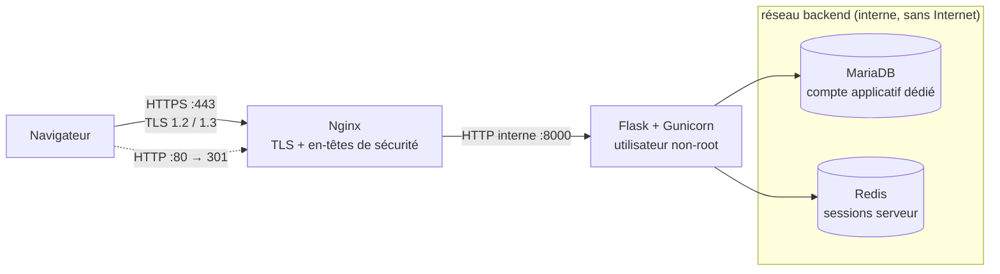
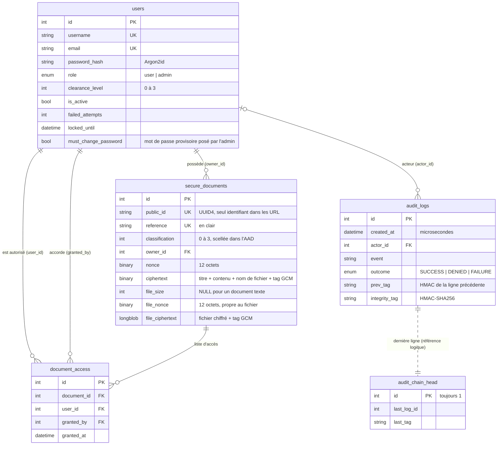

# 🔐 SecureAuth — Coffre-fort de documents classifiés


Application Web de **gestion de documents classifiés** (PUBLIC → TRÈS SECRET) construite
autour de l'authentification, du contrôle d'accès côté serveur et de la cryptographie.
Projet 2 du module Cybersécurité (TEK-UP) : *Système sécurisé d'authentification et de cryptographie*.

> L'authentification n'est que la porte d'entrée. Le cœur du projet : **décider qui peut lire
> quel document, le faire respecter côté serveur, et le prouver.**

## Sommaire

- [Principes de sécurité](#principes-de-sécurité)
- [Architecture](#architecture)
- [Cryptographie](#cryptographie)
- [Avancement](#avancement)
- [Installation](#installation)
- [Utilisation](#utilisation)
- [Tests](#tests)
- [Structure du dépôt](#structure-du-dépôt)
- [Modèle de données](#modèle-de-données)
- [Modèle de menace](#modèle-de-menace)
- [Limites assumées](#limites-assumées)

## Principes de sécurité

| Principe | Mise en œuvre |
|---|---|
| **Pas de lecture vers le haut** (Bell-LaPadula) | Un agent ne lit jamais un document dont la classification dépasse son habilitation |
| **Besoin d'en connaître** | L'habilitation ne suffit pas : il faut figurer sur la liste d'accès du document |
| **Séparation des rôles** | L'administrateur gère comptes et habilitations mais **n'est pas un super-lecteur** |
| **Décision unique** | Toutes les autorisations passent par un seul module (`security/policy.py`) |
| **Pas de fuite d'existence** | Document non autorisé ⇒ HTTP **404**, jamais 403 |
| **Défense en profondeur** | TLS, sessions serveur, CSRF, CSP stricte, chiffrement AES-GCM, journal HMAC chaîné |

## Architecture



| Composant | Rôle |
|---|---|
| **Nginx** | Seul point d'entrée publié (80/443), terminaison TLS, en-têtes de sécurité |
| **Flask + Gunicorn** | Application, port 8000 interne uniquement, utilisateur non-root |
| **MariaDB 11.4** | Données, réseau `backend` uniquement, compte limité à sa base |
| **Redis 7** | Sessions côté serveur (révocables) et compteurs de limitation de débit |

Le réseau `backend` est `internal: true` (aucun accès Internet). L'application ne reçoit
**jamais** le mot de passe root de la base.

## Cryptographie

| Besoin | Mécanisme |
|---|---|
| Mots de passe | **Argon2id**, hash factice pour un temps de réponse identique (anti-énumération) |
| Documents | **AES-256-GCM**, nonce aléatoire unique ; `public_id`, classification et propriétaire scellés comme données associées (AAD) : changer la classification en base rend le déchiffrement impossible |
| Journal d'audit | **HMAC-SHA256 chaîné** : modifier, supprimer ou réordonner une ligne est détecté |
| Transport | TLS 1.2/1.3 avec mini-PKI OpenSSL (CA locale) |

Bibliothèques : `argon2-cffi` et `cryptography` uniquement, **aucun algorithme maison**.
Les clés (256 bits, distinctes) vivent hors de la base et sont validées au démarrage.

## Avancement

| Semaine | Phase | État |
|---|---|---|
| 1 | Infrastructure (Docker, TLS, Nginx, MariaDB, Redis, configuration) | ✅ Terminée |
| 2 | Authentification : inscription, connexion, déconnexion, sessions Redis, Argon2id, verrouillage après 5 échecs, journal d'audit HMAC | ✅ Terminée |
| 3 | Autorisation (`policy.py`), AES-256-GCM, espaces documents et administration, `seed-demo` | ✅ Terminée |
| 4 | Tests de sécurité : 25 cas du cahier des charges + 5 cas pour les comptes créés par l'admin et les fichiers (pytest + script contre les vrais services) | ✅ Réalisés ; captures Burp Suite à joindre au rapport |
| 5 | Durcissement : limitation de débit (Flask-Limiter + Nginx), HSTS, conteneur applicatif en lecture seule | ✅ Terminée |
| 6 | Livraison : README, `docs/tests-securite.md`, `docs/demo.md`, rapport LaTeX | ✅ Livrée |

## Installation

Prérequis : Docker Desktop (ou Docker Engine + Compose v2) et OpenSSL.
Sous Windows, lancez les scripts `.sh` depuis **Git Bash** ou **WSL**.

```bash
# 1. Secrets aléatoires (crée .env, ignoré par git)
bash scripts/gen_secrets.sh

# 2. Mini-PKI : CA locale + certificat serveur
bash scripts/gen_certs.sh
openssl verify -CAfile pki/ca.crt nginx/certs/server.crt     # attendu : OK

# 3. Démarrage des 4 conteneurs
docker compose up -d --build
docker compose ps                                            # attendu : healthy

# 4. Création des tables (relancer cette commande après une mise à jour : elle ajoute les colonnes manquantes sans toucher aux données)
docker compose exec app flask --app wsgi init-db

# 5. Premier administrateur (uniquement en ligne de commande ; le mot de passe est demandé, jamais passé en argument)
docker compose exec app flask --app wsgi create-admin

# 6. (démonstration) comptes alice et bob + 4 documents chiffrés
docker compose exec app flask --app wsgi seed-demo
```

Vérification (importez `pki/ca.crt` dans votre magasin de confiance pour le cadenas) :

```bash
curl --cacert pki/ca.crt https://localhost/health
# {"checks":{"database":"ok","redis":"ok"},"status":"ok"}
```

> ⚠️ Régénérer `.env` change les clés : les documents déjà chiffrés deviennent illisibles.
> Après un changement de schéma en développement : `docker compose down -v` puis relancer les étapes 3 et 4.

## Utilisation

| Rôle | Ce qu'il peut faire |
|---|---|
| **Agent** (`user`) | Créer des documents texte ou **déposer un fichier PDF, DOC ou DOCX** (jusqu'à son habilitation), lire et télécharger ceux dont il est sur la liste d'accès, partager les siens, changer son mot de passe |
| **Administrateur** (`admin`) | **Ajouter un utilisateur** en choisissant son habilitation, **déposer un document en choisissant sa classification** (à tous les niveaux), modifier habilitations et activation, voir les métadonnées des documents (jamais le contenu), gérer les listes d'accès, consulter et vérifier le journal. **Ne lit aucun document** au-dessus de sa propre habilitation (0). |

**Ajouter un utilisateur** (`/admin/users/new`) : l'administrateur saisit nom, e-mail, habilitation (0 à 3) et un mot de passe
**provisoire**. Le compte est un compte agent (jamais administrateur : cela reste réservé à `create-admin`). À sa première connexion, l'agent
est redirigé vers le changement de mot de passe et ne peut rien faire d'autre avant de l'avoir remplacé.

**Déposer un fichier** (`/documents/upload`, bouton sur la page *Documents*) : PDF, DOC ou DOCX, 8 Mo au plus. Le type est vérifié
par l'extension **et** par la signature du contenu ; le fichier et son nom sont chiffrés (AES-256-GCM, nonce propre, classification scellée dans
les données associées) ; il ne se télécharge qu'en pièce jointe, avec un type fixé par le serveur. L'agent classe jusqu'à son habilitation ;
l'administrateur classe à tous les niveaux mais, ne pouvant pas lire au-dessus de la sienne, **confie** le document à des agents habilités
(page *Gérer les accès*).

Routes principales : `/auth/{register,login,logout,password}`, `/documents/`, `/documents/new`, `/documents/upload`, `/documents/<uuid>`,
`/documents/<uuid>/download`, `/documents/<uuid>/access`, `/admin/`, `/admin/users`, `/admin/users/new`, `/admin/documents`, `/admin/audit`,
`/admin/audit/verify`, `/health`.

Commandes (`docker compose exec app flask --app wsgi ...`) : `init-db`, `create-admin`, `seed-demo`, `verify-audit`.
Le déroulé de la démonstration finale est dans [`docs/demo.md`](docs/demo.md).

## Tests

```bash
python -m venv .venv
.venv/Scripts/activate            # Linux/macOS : source .venv/bin/activate
pip install -r app/requirements-dev.txt
cd app && python -m pytest -q
```

Les tests utilisent SQLite en mémoire et Redis simulé (`fakeredis`) : aucun secret réel, aucun conteneur requis.
Ils couvrent mots de passe, authentification, verrouillage, sessions, politique d'accès, chiffrement, documents, partage,
administration, journal d'audit (modification, suppression, permutation), limitation de débit, jeu de démonstration et
configuration de l'infrastructure.

Contre les **vrais services** (Nginx, MariaDB, Redis) : `python scripts/live_checks.py --demo-password ... --admin-password ...`
(TLS, en-têtes, cookies, IDOR, attaques directes en base, rafale de connexions). Les résultats sont archivés dans
[`docs/preuves/`](docs/preuves/) et rapprochés des 25 cas du cahier des charges dans
[`docs/tests-securite.md`](docs/tests-securite.md).

## Structure du dépôt

```
secure-auth-platform/
├── docker-compose.yml           # 4 services, 2 réseaux (backend interne), conteneur app durci
├── .env.example                 # modèle ; le vrai .env est généré et ignoré par git
├── nginx/nginx.conf             # TLS, redirection 301, en-têtes, HSTS, limitation de débit
├── scripts/                     # gen_secrets.sh, gen_certs.sh, live_checks.py
├── docs/                        # cahier des charges, tests-securite.md, demo.md, preuves/, rapport LaTeX
└── app/
    ├── Dockerfile
    ├── requirements.txt / requirements-dev.txt
    ├── wsgi.py
    ├── secureauth/
    │   ├── config.py            # secrets obligatoires, clés 256 bits distinctes validées
    │   ├── models.py            # users, secure_documents, document_access, audit_logs, audit_chain_head
    │   ├── auth/                # inscription, connexion, verrouillage, sessions, mot de passe
    │   ├── documents/           # liste, création, lecture, partage (routes, service, formulaires)
    │   ├── admin/               # comptes, habilitations, documents (métadonnées), journal
    │   ├── security/
    │   │   ├── policy.py        # point de décision unique de l'autorisation
    │   │   ├── crypto.py        # AES-256-GCM (données associées : id public, classification, propriétaire)
    │   │   ├── audit.py         # journal HMAC-SHA256 chaîné
    │   │   ├── passwords.py     # Argon2id, hash factice, politique
    │   │   └── decorators.py    # login_required, role_required
    │   └── cli.py               # init-db, create-admin, seed-demo, verify-audit
    └── tests/
```

## Modèle de données



## Modèle de menace

| Menace | Contre-mesure |
|---|---|
| Énumération de comptes | Message d'erreur unique, hash factice |
| Force brute | Argon2id, verrouillage 15 min après 5 échecs, limitation de débit (Flask-Limiter + Nginx, HTTP 429) |
| Vol / fixation de session | Cookie `__Host-sid` (Secure, HttpOnly, SameSite=Lax), régénération à la connexion |
| CSRF | Jeton Flask-WTF + SameSite |
| IDOR, lecture vers le haut | `policy.can_read()` systématique, 404 uniforme |
| Abus de l'administrateur | Séparation des rôles, auto-modification interdite, tout est journalisé |
| Accès direct à la base | Chiffrement AES-256-GCM, clé hors base |
| Déclassement frauduleux | Classification scellée dans les données associées GCM |
| Effacement de traces | Chaîne HMAC + tête de chaîne |
| Injection SQL, XSS | ORM SQLAlchemy, échappement Jinja2, CSP stricte |
| Fichier déposé piégé ou déguisé | Liste blanche PDF/DOC/DOCX, signature du contenu contrôlée, 8 Mo max, jamais affiché (pièce jointe, `nosniff`), nom nettoyé |
| Mot de passe provisoire connu de l'administrateur | Changement imposé avant toute autre action |

## Limites assumées

- Un attaquant qui modifie directement `clearance_level` en base n'est pas détecté (amélioration envisagée : tag HMAC sur les habilitations).
- Le verrouillage de compte peut être utilisé pour du déni de service ciblé (atténué par la limitation de débit par IP).
- HSTS est activé avec une durée courte (5 minutes) pour ne pas piéger `localhost` ; à porter à un an en production.
- Un administrateur peut, de concert avec un complice, élever son habilitation et lui donner accès : l'action est journalisée mais pas empêchée.
- La CA locale n'a ni CRL ni OCSP.
- Les fichiers déposés sont contrôlés (format, taille) mais **pas analysés** contre les logiciels malveillants : un PDF bien formé peut contenir du code actif. C'est pourquoi ils ne s'ouvrent jamais dans le navigateur.
- L'administrateur classe à tous les niveaux : il peut donc déposer un document dont il choisit la classification, mais il ne peut pas le lire (pas de lecture vers le haut) ; la création de comptes administrateur reste en ligne de commande.
- Hors périmètre : MFA, *no write down*, rotation des clés, API publique, aperçu des documents dans le navigateur.

## Licence

Projet académique : usage pédagogique.
